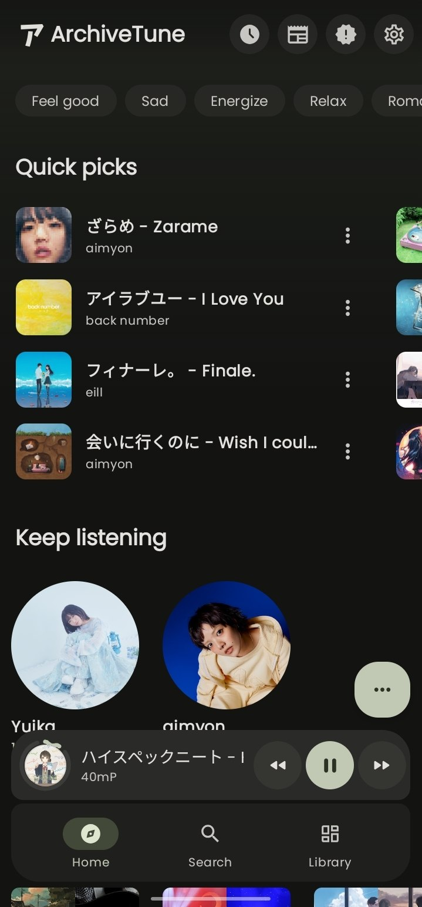
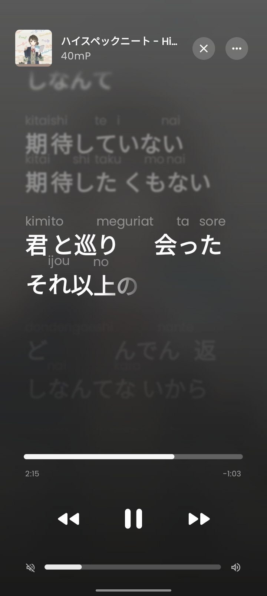
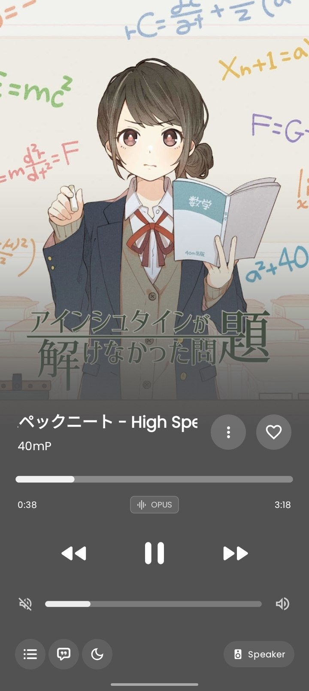

<div align="center">

  

  <h1>ArchiveTune (Extended Edition)</h1>
  <p><em>An extended feature-rich edition based on <a href="https://github.com/rukamori/ArchiveTune">ArchiveTune by rukamori</a> &amp; <a href="https://github.com/ddinjustices/OuterTune">OuterTune</a></em></p>

  <p align="center">
    <strong>Universal Android Music Player with Multi-Source Streaming, Advanced DSP &amp; Dynamic UI</strong>
    <br />
    <em>Supporting YouTube Music, Spotify, SoundCloud, Tidal, Local Audio, Bit-Perfect DSP, and 10+ Player Styles.</em>
  </p>

  <p align="center">
    <a href="#-extended-features--overview"><b>Extended Features</b></a> •
    <a href="#-feature-comparison-original-vs-extended-edition"><b>Comparison</b></a> •
    <a href="#-download-releases"><b>Download</b></a> •
    <a href="#-screenshots"><b>Screenshots</b></a> •
    <a href="https://github.com/S1LOnik/ArchiveTune/releases"><b>GitHub Releases</b></a>
  </p>

  <div align="center">
    <a href="https://github.com/S1LOnik/ArchiveTune/releases/latest">
      
    </a>
    <a href="https://github.com/S1LOnik/ArchiveTune/releases">
      
    </a>
    <a href="https://github.com/S1LOnik/ArchiveTune/stargazers">
      
    </a>
    <a href="LICENSE">
      
    </a>
    <a href="https://github.com/S1LOnik/ArchiveTune/actions/workflows/build_and_release.yml">
      
    </a>
  </div>

</div>

<hr />

### 🌸 About the Project & Upstream Roots

**ArchiveTune** was originally created by **[rukamori](https://github.com/rukamori/ArchiveTune)** as a charming, lightweight music player focusing on local audio and YouTube Music for Android, succeeding the foundations laid by OuterTune and ViMusic.

This repository (**Extended Edition**) is an actively developed continuation that preserves the spirit of the original while significantly expanding its technical capabilities: adding full native Spotify and multi-source streaming, a real-time DSP audio engine with beat-matched Automix, 10 distinct player interfaces, animated video canvas backgrounds, an expanded 10-provider lyrics suite, and fine-grained UI scaling.

> [!NOTE]
> **📦 Official Builds & Continuous Deployment:**  
> All APK releases for this extended edition are built automatically via GitHub Actions CI/CD and published on **[GitHub Releases](https://github.com/S1LOnik/ArchiveTune/releases)** with SHA-256 integrity checksums.

---

## 📊 Feature Comparison: Original vs. Extended Edition

| Capability / Module | Original ArchiveTune | Extended Edition (This Fork) |
| :--- | :--- | :--- |
| **Streaming Sources** | Local Audio Files, YouTube Music (via InnerTube / NewPipe) | **Multi-Source Ecosystem:** Local Files, YouTube Music, native **Spotify** (`librespot-java` + Login5), **SoundCloud**, **Tidal** (lossless), **Deezer**, and **Apple Music** catalog search |
| **Source Redundancy** | Single source playback | **Universal Fallback Matrix:** Seamless automatic failover between Spotify, YouTube Music, and SoundCloud when tracks are geo-blocked or rate-limited |
| **Audio Processing & DSP** | ExoPlayer standard output, Android system equalizer | **Smart DJ Automix** (BPM beat-matching, silence trimming, tempo warping, harmonic ducking), **Bit-Perfect output**, **Decent USB Audio DAC** support, and dedicated DSP engines (`Lastwave`, `Monochrome`) |
| **Player Designs & Themes** | Signature cute anime player theme | **10+ distinct player layouts:** Flamingo (Apple Music style with album shrink), BitChord (gesture-driven UI), TikTok, SimpMusic, SpatialFlow, Looper, V8 Immersive Extended, V7, V9, V10, and Default |
| **UI Customization & Scaling** | System font scaling | **Global UI Scale slider** (`UiScaleFactorKey` modifying Compose `Density`), morphing play/pause icons with spring animations, adaptive compact floating navigation bar with frosted glass effect |
| **Lyrics & Music Recognition** | LRCLIB & Kugou basic lyrics | **10+ Lyrics Providers:** Musixmatch, LRCLIB, Paxsenix, BetterLyrics (word-by-word synchronized scrolling), Kugou, Unison, YouLyPlus, Genius, Deezer; AI translation, romanization & Japanese language pack; **ShazamKit** song recognition |
| **Artwork & Dynamic Canvas** | Static cover artwork | **Modular `:canvas` engine:** Spotify Canvaz, Apple Music motion video backdrops, Tidal canvas, and procedural algorithmic canvas |
| **Library Synchronization** | Local Room database + YouTube Music sync | **Two-way authoritative sync:** YouTube Music & Spotify (Liked Songs, saved albums, playlists) with pull-to-refresh and offline caching |
| **Release Pipeline** | Manual releases | **Automated GitHub Actions CI/CD:** Universal and ARM64-v8a signed release APKs with automated version tagging and checksums |

---

## 🚀 Extended Features & Deep-Dive

### 🎵 1. Multi-Source Streaming & Universal Fallback
* **Native Spotify Streaming (`:spotifycore`):** Integrated `librespot-java` (1.6.5) with Login5 authentication, OAuth loopback server, and Mercury/Dealer protocol support.
* **Full Spotify Library Integration:** Browse, search, and manage your Spotify Liked Songs, saved albums, and custom playlists with authoritative two-way synchronization.
* **Universal Fallback Matrix:** Never encounter a broken track. If a stream fails (e.g. YouTube HTTP 403 or regional unavailability), the player dynamically falls back to an alternative high-quality source (Spotify ↔ YTM ↔ SoundCloud) without skipping the song.
* **High-Resolution Sources:** Built-in routing for SoundCloud, Tidal (lossless FLAC), Deezer, and local device audio.

### 🎛️ 2. Smart DJ Automix & High-Fidelity DSP Engine
* **Beat-Matched Automix (`SmartDjAutomixManager`):** Real-time BPM detection, intelligent silence trimming, tempo warping, and harmonic crossfading with bass ducking.
* **Bit-Perfect Playback:** Direct-to-DAC audio routing supporting high-sample-rate audio without Android resampler interference.
* **USB Audio DAC Support:** Integrated Decent USB Audio driver subsystem for external USB DACs.
* **Integrated DSP Modules:** Dedicated equalizer engines (`com.lastwave` and `tf.monochrome`) with parametric EQ and custom sound profiles.

### 🎨 3. 10+ Player Styles & UI Personalization
* **Flamingo Theme:** Elegant Apple Music-inspired player layout with dynamic cover-art shrinking during pause/scrubbing and blurred background canvas.
* **BitChord Theme:** High-interactivity layout with spring-loaded physical gesture controls and dedicated BitChord navigation bar.
* **Immersive Extended (V8) & SpatialFlow:** Full-screen edge-to-edge album visualizer designed for AMOLED displays.
* **Diverse Additional Styles:** TikTok, SimpMusic, Looper, V7, V9, V10, and Classic Default.
* **True UI Scale Factor:** Fine-tune the entire app interface scale independently from system display size via an in-app density multiplier.
* **Adaptive Navigation Bar:** Frosted glass floating navigation toolbar that dynamically morphs and minimizes upon scrolling.

### 📜 4. Comprehensive Lyrics Suite & Song Recognition
* **Word-by-Word Synchronized Lyrics:** Rich, animated scrolling lyrics powered by BetterLyrics, Musixmatch, LRCLIB, Paxsenix, Kugou, Unison, and YouLyPlus.
* **Multilingual AI Translation & Romanization:** Built-in Romanization and AI-powered translation for international tracks, plus a specialized Japanese language pack.
* **Lyrics Share Card Creator:** Export shareable, aesthetic lyric snippet cards (`LyricsImageCard`) with custom backgrounds and styling.
* **Integrated ShazamKit Recognition:** Identify playing songs from the outside world directly within the app.

### 🎬 5. Dynamic Motion Canvas & Video Artwork
* **Spotify Canvaz Protocol:** Stream authentic short looping video artwork directly from Spotify.
* **Motion Video Backdrops:** Support for Apple Music motion covers, Tidal canvas, and procedural geometric visuals.

---

## 📥 Download Releases

Always download verified APKs directly from GitHub Releases:

<div align="center" id="download-releases">

### 🌟 [Download Latest ArchiveTune Release](https://github.com/S1LOnik/ArchiveTune/releases/latest)

| Architecture | Package | Compatibility |
| :---: | :---: | :---: |
| **Universal (Recommended)** | [`ArchiveTune-v16.1.2-universal.apk`](https://github.com/S1LOnik/ArchiveTune/releases/latest) | Works on all 64-bit and 32-bit Android devices (Android 8.0+) |
| **ARM64-v8a (Optimized)** | [`ArchiveTune-v16.1.2-arm64-v8a.apk`](https://github.com/S1LOnik/ArchiveTune/releases/latest) | Smaller package size for modern 64-bit devices |

</div>

> [!TIP]
> **Installation Troubleshooting ("App not installed" error):**  
> If your device says *"App not installed. An app with the same signature has already been installed"*, please check if ArchiveTune is installed under another profile or clone (e.g. **System Clone / Second Space / Dual Apps / User 11** on ColorOS, OxygenOS, or MIUI).  
> Because different developers and CI builds use different signing certificates, all previous instances from other sources must be uninstalled across all user profiles before installing this build.

---

## 📸 Screenshots

<div align="center" id="screenshots">





</div>

---

## 🛠️ Building from Source

To build ArchiveTune Extended locally:

```bash
# Clone the repository
git clone https://github.com/S1LOnik/ArchiveTune.git
cd ArchiveTune

# Build Universal Release APK
./gradlew :app:assembleGmsMobileUniversalRelease

# Build ARM64 Release APK
./gradlew :app:assembleGmsMobileArm64Release
```

Compiled APKs will be output to `app/build/outputs/apk/gmsMobile/release/`.

---

## ⚖️ Credits & Attribution

* **[rukamori/ArchiveTune](https://github.com/rukamori/ArchiveTune)** — The wonderful upstream project that gave ArchiveTune its distinctive design and spirit.
* **[OuterTune](https://github.com/ddinjustices/OuterTune)** & **[ViMusic](https://github.com/vfsfitvnm/ViMusic)** — Foundations of open-source YouTube Music streaming on Android.
* **[librespot-java](https://github.com/librespot-org/librespot-java)** — Open-source Spotify client library enabling native playback.
* **[NewPipe Extractor](https://github.com/TeamNewPipe/NewPipeExtractor)** — Reliable YouTube stream extraction.
* Licensed under the **[GNU General Public License v3.0 (GPLv3)](LICENSE)**.

<div align="center">
  <p><em>Built with ❤️ by the open-source music community.</em></p>
</div>
